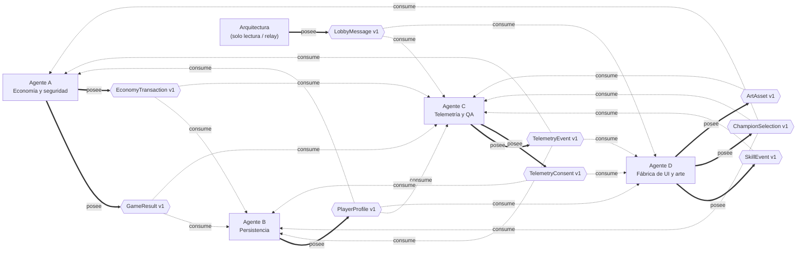
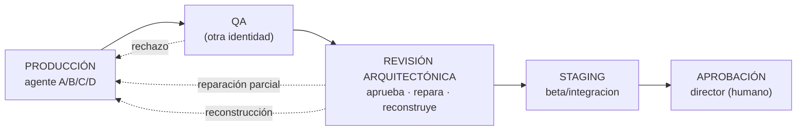

# Dependencias entre agentes y contratos

> Generado por `node tools/agents/gen-diagram.js` desde `contracts/registry.json` y `docs/arquitectura-compartida/ownership.json`. No editar a mano: `--check` falla si no coincide.

## Contratos: quién los posee y quién los consume

## Flujo de revisión independiente

## Áreas del proyecto

| Área | Contratos | Dueños |
|---|---|---|
| economia_transacciones | GameResult, EconomyTransaction | A |
| persistencia_usuarios | PlayerProfile | B |
| telemetria_consentimiento | TelemetryEvent, TelemetryConsent | C |
| hud_eventos_habilidades | SkillEvent | D |
| seleccion_campeones | ChampionSelection | D |
| lobby_multijugador | LobbyMessage | ARQ |
| fabrica_artistica_ui | ArtAsset | D |

## Contratos

| Contrato | Dueño | Consumidores | Productor | Esquema |
|---|---|---|---|---|
| GameResult | A | B, C | `server/item-economy-live.js` | `contracts/v1/game-result.schema.json` |
| EconomyTransaction | A | B, C | `server/wallet.js` | `contracts/v1/economy-transaction.schema.json` |
| PlayerProfile | B | A, C, D | `server/accounts.js` | `contracts/v1/player-profile.schema.json` |
| TelemetryEvent | C | A, B, D | `js/net/alpha-services.js` | `contracts/v1/telemetry-event.schema.json` |
| TelemetryConsent | C | D, B | `js/net/alpha-services.js` | `contracts/v1/telemetry-consent.schema.json` |
| SkillEvent | D | C | `js/ui/hud.js` | `contracts/v1/skill-event.schema.json` |
| ChampionSelection | D | A, B, C | `js/ui/champion-select.js` | `contracts/v1/champion-selection.schema.json` |
| ArtAsset | D | C | `tools/factory/cli.js` | `contracts/v1/art-asset.schema.json` |
| LobbyMessage | ARQ | C, D | `server/relay.js` | `contracts/v1/lobby-message.schema.json` |

## Agentes

| Agente | Rama | Contratos que posee | Depende de |
|---|---|---|---|
| A — Economía y seguridad | `claude/s1-economia-…` | GameResult, EconomyTransaction | contracts/v1 |
| B — Persistencia | `claude/s2-persistencia-…` | PlayerProfile | contracts/v1 |
| C — Telemetría y QA | `claude/s3-telemetria-…` | TelemetryEvent, TelemetryConsent | contracts/v1 |
| D — Fábrica de UI y arte | `claude/s4-ui-…` | SkillEvent, ChampionSelection, ArtAsset | contracts/v1 |
