# Guerra de Cristales — identidad del mapa

Pedido del dueño (con libertad creativa): "al mapa le falta muchísimo color y onda; la arena tiene que tener una identidad".
Esta entrega rediseña SOLO el aspecto del escenario del motor de carriles (`js/arenas/lanes/`). No toca `js/net/*`, `server/*`,
bots (`lanes-bot-ai.js`, `lanes-bots.js`), campeones ni habilidades, ni la geometría jugable.

La imagen de concepto adjunta se usó solo como referencia de composición, color y tono. No está en el repositorio ni se usó como
asset (política de arte generado por IA sin decidir). Todo el arte nuevo es procedural propio (código) más los sprites que el juego
ya tenía (`assets/sprites/battlefield/*`: columnas, arcos, braseros, hongos, huesos, helechos, torres, árboles).

## Capturas (antes / después)

Playwright + Chromium, partida de entrenamiento, el héroe se teletransporta a cada punto. 844×390 y 667×375.

| Punto | Antes 844×390 | Después 844×390 | Antes 667×375 | Después 667×375 |
|---|---|---|---|---|
| Base Zafiro | 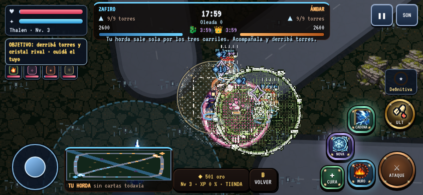 | 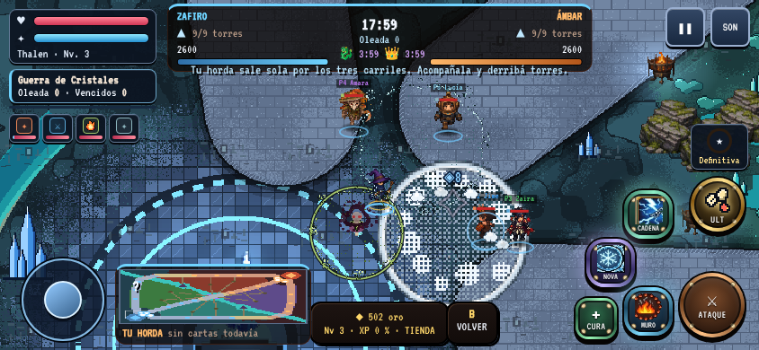 | 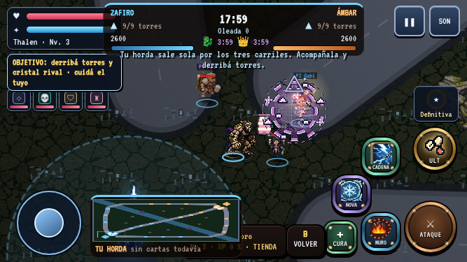 | 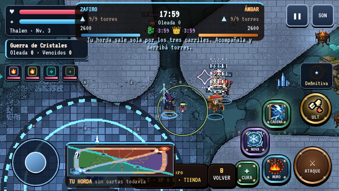 |
| Base Ámbar | 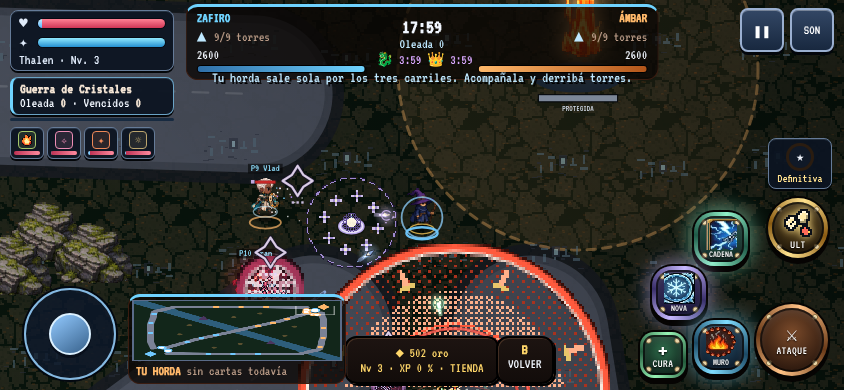 | 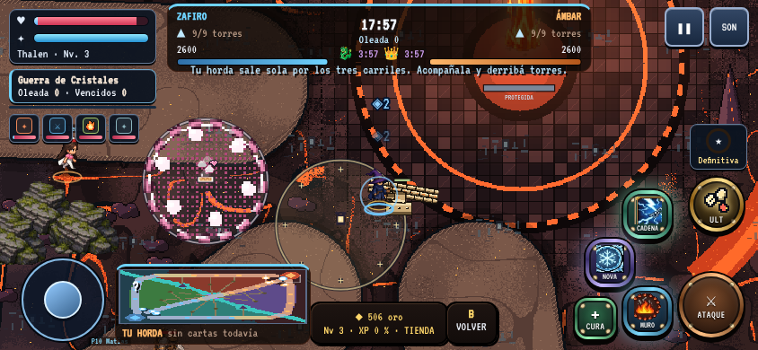 | 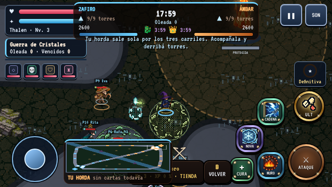 | 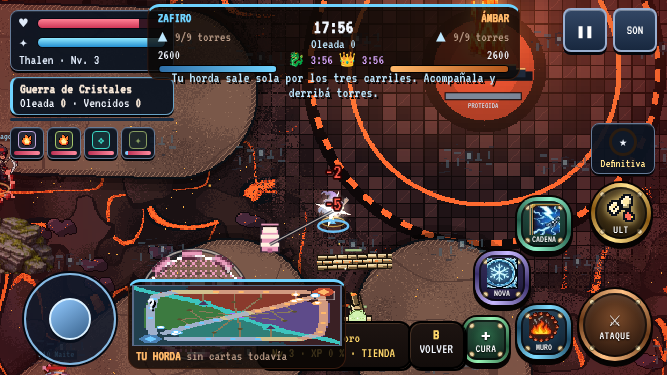 |
| La Convergencia (centro) | 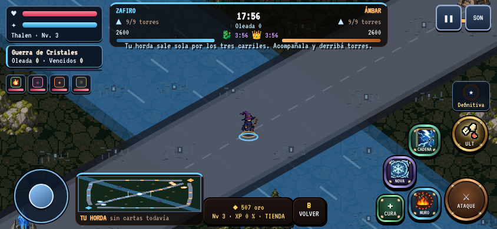 | 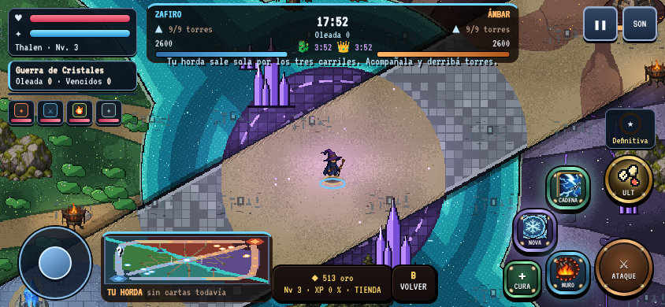 | 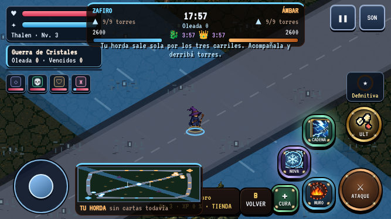 | 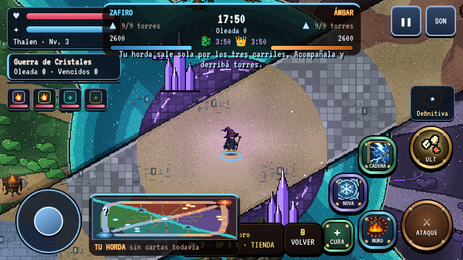 |
| Campamento (Bosque Ancestral) | 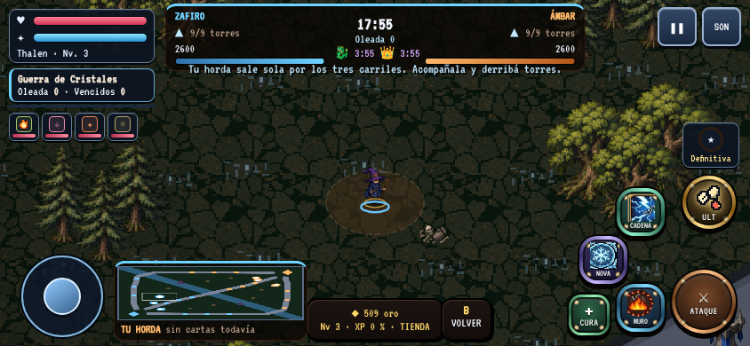 | 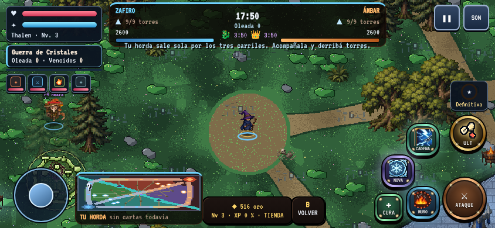 | 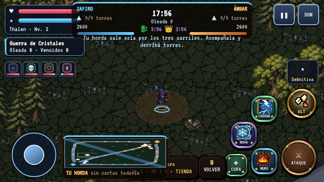 | 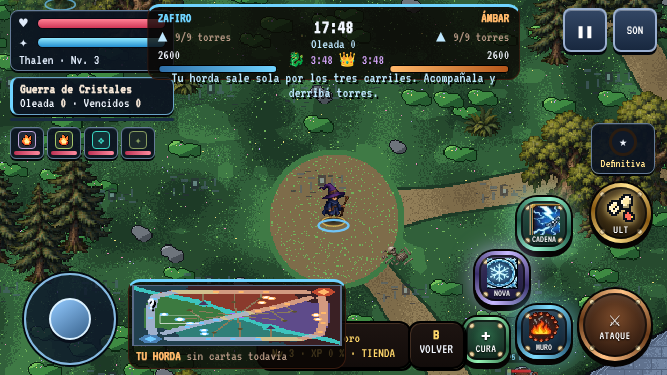 |
| Foso del Dragón de Piedra | 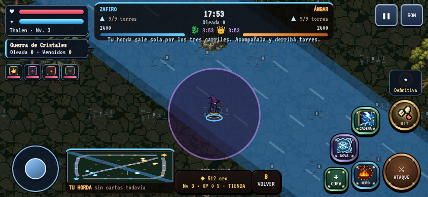 | 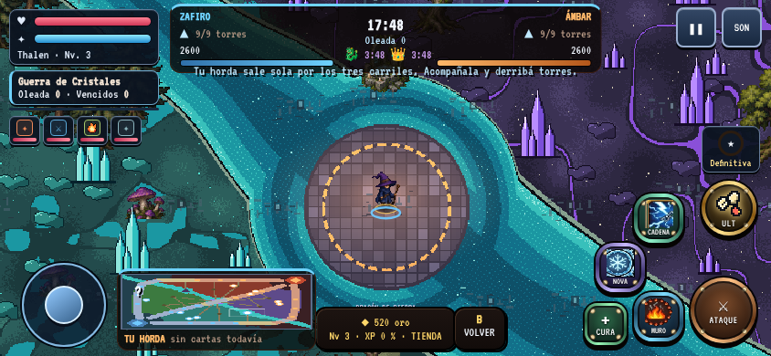 | 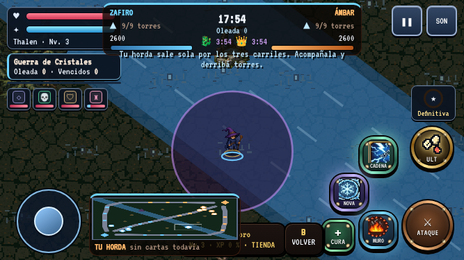 | 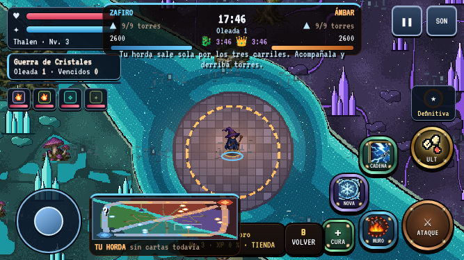 |
| Carril superior | 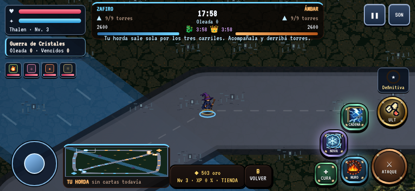 | 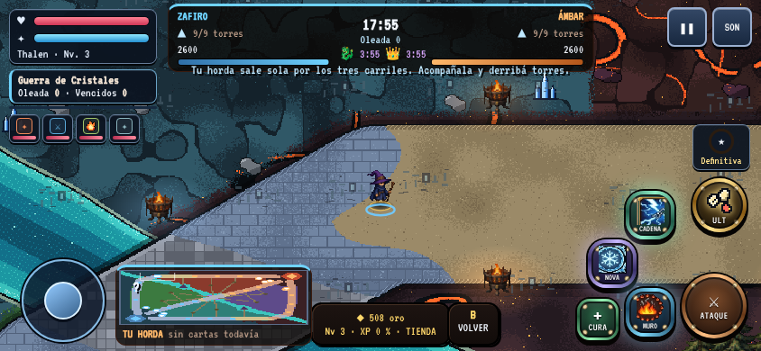 | 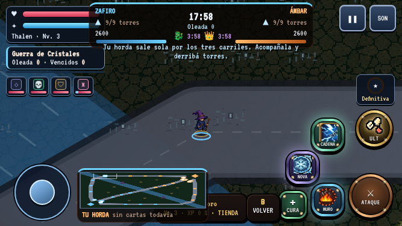 | 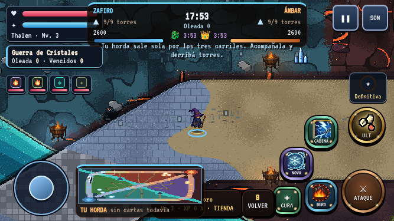 |

Mapa completo horneado (a 1/4 de escala, vista de diseño): `mapa_completo_horneado.png`. Leyenda abierta: `despues/leyenda_844.png`, `despues/leyenda_667.png`.

## Decisiones de diseño

**Geometría intacta.** Carriles (`LANES_PATHS`), torres, cristales, campamentos y épicos se LEEN de `lanes-data.js`; nada se mueve y nada
colisiona de más. El decorado horneado es plano; los sprites reales agregados usan `battlefieldProp(..., r=0)` (sin sólido) y las
piezas altas propias (cristales, espinas) se ordenan por profundidad y se atenúan si un héroe queda detrás, pero tampoco colisionan.
Los sólidos y la navegación son exactamente los de antes (la colocación de árboles y rocas sólidas no cambió: usa su propio RNG).

**Zonas** (`lanes-art-field.js`, una sola función `lnaField(x, y)` que dice a qué zona pertenece cada punto):

| Zona | Dónde | Identidad |
|---|---|---|
| Bosque Ancestral | cuña izquierda (lobos y bestias de Zafiro) | pasto verde, flores, arbustos, helechos y rocas con musgo |
| Jungla Volcánica | cuña de arriba (escorpiones y gigante de Ámbar) | basalto con grietas de lava, brasas que suben, espinas de obsidiana |
| Pantano Cristalino | cuña de abajo (escorpiones y gigante de Zafiro) | verde-azulado, charcos turquesa, cristales turquesa, hongos |
| Necrópolis | cuña derecha (lobos y bestias de Ámbar) | piedra violeta con vetas luminosas, huesos, cristales violeta, árboles muertos |
| Riscos azules / Roca volcánica | bordes y alrededores de cada base | roca fría (lado Zafiro) y roca negra con lava (lado Ámbar), oscura para que no compita con la acción |

**Lado del equipo.** Zafiro: plaza de piedra azulada con anillos rúnicos celestes, foso de agua fría por el lado de la esquina, pilares de
cristal azul, torres con brillo frío. Ámbar: plaza de basalto, foso de lava, espinas de obsidiana, torres con brillo cálido. Cada
base tiene luz propia (aidLights) y una peana escalonada bajo el cristal con el color del equipo (en píxel, sin antialias). El anillo
punteado de curación (radio 300) sigue ahí, horneado como anillo de runas.

**Centro violeta.** La Convergencia es una plataforma de piedra violeta con runas rodeada de un anillo de agua turquesa; el carril
central la cruza como puente de piedra y dos cristales violeta grandes flanquean el carril. Destellos rúnicos animados.

**Río.** Serpentea (en vez de la diagonal recta) pasando por los dos épicos; cada épico queda en un estrado de piedra con foso de agua.
Es agua poco profunda: se cruza caminando como antes (no hay colisión nueva). Donde un carril la cruza hay un puente de piedra con parapetos.

**Carriles y senderos.** Carriles claros y de tono medio con borde oscuro de 1 px y bordillo (adoquín azul en el lado Zafiro, tierra en el
centro, basalto marrón con grietas en el lado Ámbar), más oscuros fuera: el suelo transitable se separa de la decoración. Senderos
de tierra con contorno conectan cada campamento con su carril. Antorchas (brasero del juego + luz) a ambos lados de cada carril cada ~560 u.
El carril superior suma columnas y arcos (Ruinas Élficas). Arbustos de emboscada: grupos junto a los carriles (SOLO decorado, no
ocultan a nadie: el juego no tiene sigilo).

**Campamentos reconocibles por zona.** Claro de musgo y tierra (bosque), placa de basalto con lava (volcánica), poza turquesa (pantano),
placa violeta con anillo de runas (necrópolis). El anillo dorado punteado del campamento vivo sigue siendo dinámico.

**Minimapa y leyenda.** El minimapa dibuja el mapa de zonas horneado (mismos colores que la leyenda, `LNA_MINI`) y encima los
marcadores dinámicos de siempre (torres, cristales, hordas, héroes, campamentos, épicos). Botón `?` de 44 px sobre el minimapa abre
la leyenda (texto de 14 px o más, sin desbordes, no tapa controles). La leyenda describe SOLO lo que existe en el juego: no hay
teletransportes ni "cristal secundario" ni emboscada con mecánica, así que no figuran.

**Canon de píxel (ART_BIBLE §14).** Suelo a 2 u/px nativo (1 px de imagen = 2 u), `imageSmoothingEnabled = false`, paleta corta por zona
(≤ 4 tonos + acentos), sin degradés en lo propio, tramado por hash por píxel (bordes de zona, desvanecido de la plaza). Los sprites
procedurales se dibujan con `fillRect` y contorno de 1 px. Las luces aditivas (`glowSprite`) son el sistema existente del juego.

## Costo por cuadro (horneado)

El fondo se hornea en trozos de 128×128 px (256 u), de forma perezosa y en rebanadas con plazo (4 ms por cuadro si falta algo visible,
1,5 ms para precargar el anillo; los primeros cuadros hornean todo lo visible de una vez). Mientras un trozo no está listo se muestra
la silueta de zonas del minimapa. Por cuadro solo hay `drawImage` de los trozos visibles (~25–40). Memoria: LRU de 150 trozos = 150 × 64 KB ≈ 9,6 MB
(más ~0,2 MB de sprites y el minimapa de 240×180). No se mantiene un lienzo de 30 MB del mundo entero.

Mediciones (Chromium headless, viewport 844×390, CPU ×4 con `Emulation.setCPUThrottlingRate`, 150 cuadros `render()` por punto, medianas,
ms por cuadro). **Aviso:** la máquina de pruebas estaba muy cargada por otras sesiones (load average 27–38 en 4 núcleos), así que los valores
absolutos están inflados y ruidosos; la comparación antes/después se hizo en las mismas condiciones, pero conviene repetirla en un equipo tranquilo y en un celular real.

| Punto | `render()` antes (mediana / p90) | `render()` después | `drawWorld` antes / después |
|---|---|---|---|
| Base Zafiro | 2,6 / 15,3 | 4,7 / 14,1 | 0,1 / 0,1 |
| Carril medio | 4,4 / 10,7 | 5,2 / 11,4 | 0,1 / 0,1 |
| Centro | 1,6 / 11,4 | 1,6 / 7,3 | 0,1 / 0,1 |
| Selva | 2,1 / 13,1 | 2,3 / 5,0 | 0,1 / 0,1 |
| Río / épico | 1,4 / 9,5 | 1,0 / 5,0 | 0,1 / 0,1 |

En régimen (todo horneado) el costo es equivalente, dentro del ruido. El costo nuevo aparece al **explorar terreno nuevo**: horneado ≈ 30 ms por
trozo en estas condiciones (CPU ×4 + máquina cargada; ≈ 3,5–9 ms mínimos medidos con CPU ×1 en la misma máquina cargada), repartido en rebanadas.
Prueba de recorrido del carril superior a 700 u/s (el doble de la velocidad normal), CPU ×4: mediana de `render()` 5,6–10,3 ms antes frente a
19–20 ms después, con picos máximos similares (97–148 ms antes; 162–164 ms después, de pocas muestras); ese sobrecosto es el presupuesto de horneado
mientras hay terreno sin cubrir, y desaparece al detenerse. **No está resuelto del todo:** si en un celular real se nota tirón al correr por zonas nuevas,
las opciones son subir la precarga, hornear en un Worker con OffscreenCanvas o bajar la complejidad del píxel (anotado como pendiente).
Construcción inicial del decorado + minimapa: ≈ 50–65 ms una vez por sesión (con la carga de la máquina).

## Pruebas

Ver la descripción del PR para el resultado exacto de cada comando. Agregado: la leyenda se verificó con un script ad hoc (botón ≥ 44 px, texto ≥ 14 px, sin desborde, sin
solaparse con controles, 844×390 y 667×375); no quedó como prueba del repositorio.

## Provisional / necesita artista humano

- **Todo el arte es procedural y provisional.** Sirve para dar identidad y legibilidad ahora; un artista debería pintar a mano: puentes, cascadas (hoy hay agua y foso, no cascadas), ruinas, plazas de las bases, campamentos con su criatura-guardián identificable (hoy se reutilizan los monstruos de siempre: gólem, lobo, etc.) y las cuatro junglas.
- No hay guardianes únicos por jungla (piedra del Bosque, jefe de lava, serpiente de la Necrópolis) ni teletransportes: son del concepto, no del juego.
- Los sprites procedurales (cristales, espinas, arbustos, peanas) no pasaron revisión de arte ni de la dirección de píxel del proyecto (`tools/art/pixel-density.js` no los mide).
- El minimapa en celular horizontal se muestra aplastado (210×61 px para un lienzo 4:3): es el CSS previo, no se cambió para no mover el HUD; merece un rediseño.
- El río y los fosos se pisan como suelo (como antes). Si se quiere agua que ralentice o bloquee, es una decisión de gameplay aparte.
- Falta probar en un celular real y en Safari; las capturas son emulación de Chromium.
